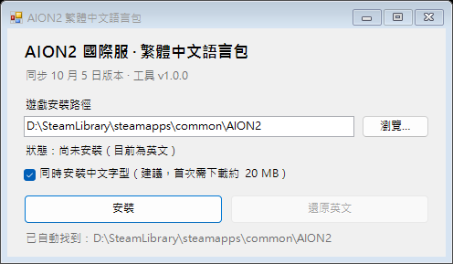

# AION2 國際服 · 繁體中文語言包

<p align="center">
  
</p>

給 **AION2（永恆之塔 2）國際服（Steam / PURPLE）** 使用的繁體中文語言包，附一個輕便的一鍵安裝工具。

- 單一 exe、約 4 MB，免安裝，語言包已內嵌
- 自動搜尋 Steam 版與 PURPLE 版的遊戲安裝路徑
- 一鍵安裝、一鍵還原英文
- 啟動時自動檢查 GitHub Release 新版本，一按即自動下載、驗證、替換並重啟
- 支援 64 位元 Windows 10 / 11

> 台服本身已是繁體中文，不需要這個語言包。

## 下載

到 [**Releases**](https://github.com/Monohitoxx/Steam-AION2-TraditionalChinese/releases/latest) 下載 `AION2_CHT.exe`。

## 使用方法

1. 關閉遊戲。
2. 執行 `AION2_CHT.exe`。工具會先讀 Steam 的安裝記錄，再在背景掃描所有硬碟上的 `AION2` 資料夾（Steam 版例如 `D:\SteamLibrary\steamapps\common\AION2`，PURPLE 版通常直接放在 `D:\AION2`）。**找到多個時會列出讓你選**；任何時候也可以按「瀏覽…」自己指定資料夾。
3. 按「安裝」，完成後啟動遊戲即可。
4. 想換回英文時按「還原英文」。

啟動時工具會順便查一下 GitHub Release 有沒有新版本（同 `AION2_CHT.exe` 的檔案版本比較）。有新版會問你要不要更新：確認後會自動下載、用 Release 附帶的 SHA-256 驗證，再替換自己並重新啟動，之後照樣按「安裝」即可。不想被檢查的話，用 `/noupdate` 啟動或者設定環境變數 `AION2_CHT_NO_UPDATE=1`。

### 關於中文字型

勾選「同時安裝中文字型」時，工具會安裝含完整中日韓字形的 Noto Sans CJK 字型，讓遊戲內的中文顯示更完整。字型約 20 MB，沒有包在 exe 裡，首次安裝時會從本倉庫下載。也可以自行下載 [`langpack/NotoSans-Bold.ufont`](langpack/NotoSans-Bold.ufont) 放在 exe 旁邊，工具會優先使用本機檔案。

## 注意事項

- **遊戲更新後需要重新安裝**：Steam 更新會把語言 pak 蓋回英文，再開一次工具按「安裝」即可。工具一偵測到 pak 被還原，狀態就會顯示「語言檔已被遊戲更新還原，請再按『安裝』」。遊戲新增的文字要等語言包更新後才會有中文。
- **還原英文**：安裝時會把原始英文語言檔備份到遊戲目錄下的 `_AION2_CHT_Backup`，按「還原英文」時放回去。如果之前用過其他漢化工具、原始檔已不在，工具無法還原，請在 Steam 對 AION2 執行「驗證遊戲檔案完整性」；反過來，如果遊戲更新已經把原始 pak 還原，就不需要備份，工具會直接沿用現有的原始檔。
- **防毒軟體警告**：exe 沒有數位簽章，部分防毒會誤報、SmartScreen 第一次執行也會攔截（按「其他資訊 → 仍要執行」即可）；原因、驗證方法與回報管道見[防毒軟體誤報](#防毒軟體誤報)。原始碼都在本倉庫，Release 內的 exe 由 GitHub Actions 從原始碼建置。
- **沒有寫入權限**：遊戲裝在 `Program Files` 之類的位置時，請以系統管理員身分執行。
- **風險自負**：這是非官方的玩家自製語言包，會替換遊戲的語言檔，與 NCSOFT 無關。

## 語言包內容

- 目前版本同步 **10 月 5 日**的遊戲版本，共 152,723 筆文字。
- 補上原本未翻譯的成就、道具、稱號與介面文字。
- 刻意保留英文的部分：伺服器名稱、`MAX`／`PVP`／`DPS` 等慣用縮寫、圖形技術名稱。

發現錯字或漏翻，歡迎開 [Issue](https://github.com/Monohitoxx/Steam-AION2-TraditionalChinese/issues) 回報。

## 防毒軟體誤報

這個工具會被部分防毒軟體誤判（最常見是 Microsoft Defender 報 `Trojan:Win32/Wacatac.B!ml`，另外 Avast / AVG / Bitdefender 等亦偶爾中招）。原因是三個特徵疊加起來很像惡意程式，但每一項都是這個工具的必要功能：

- **未經數位簽章的新執行檔**：沒有簽章、也沒有下載信譽，機器學習模型會直接給高分。
- **內嵌高熵資料**：語言包本體是加密（AES）過的遊戲文字檔，熵值接近 8，看起來就像被包裝過的惡意酬載。
- **改寫遊戲目錄檔案**：安裝時會備份並替換 `Aion2\Content\Paks\L10N\Text\en-US\` 的語言 pak，行為跟「遊戲破解／漢化補丁」一模一樣。

### 你可以自己驗證

- Release 頁面附有 `AION2_CHT.exe.sha256`，下載後用 `certutil -hashfile AION2_CHT.exe SHA256` 核對。
- 所有原始碼（`AION2_CHT.cs`、`build.bat`、`.github/workflows/release.yml`）都在本倉庫，Release 的 exe 由 GitHub Actions 從原始碼建置；你也可以自己執行 `build.bat` 編譯。
- 工具不會寫登錄檔、不會自我複製或執行其他程式；網路請求只有兩個（都可以關掉）：啟動時查 GitHub Release 有沒有新版本（`/noupdate` 或環境變數 `AION2_CHT_NO_UPDATE=1`），以及（可選）下載中文字型。

### SmartScreen 攔截（未簽章 exe 一定會遇到）

見到「**Microsoft Defender SmartScreen 已防止某個無法辨識的應用程式啟動**」時：

1. 按「**更多資訊**」→「**仍要執行**」，今次就可以開。
2. 想以後唔再彈，先幫個檔案「解除封鎖」（SmartScreen 對下載檔案嘅檢查係靠檔案的「來自互聯網」標記，即 MOTW）：

   ```powershell
   Unblock-File .\AION2_CHT.exe          # 或者右鍵 → 內容 → 一般 → 勾「解除封鎖」
   ```

   亦可以用命令列下載（`Invoke-WebRequest` 唔會加 MOTW）：

   ```powershell
   iwr https://github.com/Monohitoxx/Steam-AION2-TraditionalChinese/releases/latest/download/AION2_CHT.exe -OutFile AION2_CHT.exe
   .\AION2_CHT.exe
   ```

## 運作原理

遊戲的所有文字都在 `L10NString.dat` 這個「鍵 → 文字」對照表裡。國際服沒有中文語系，所以語言包的做法是替換**英文語系（en-US）**的文字檔，遊戲以為自己在顯示英文，實際讀到的是中文。

安裝時會做三件事：

| 動作 | 檔案 |
|---|---|
| 把原始英文語言 pak 備份後換成空檔，讓遊戲改讀外部文字檔 | `Aion2\Content\Paks\L10N\Text\en-US\pakchunk502000-Windows_0_P.*` |
| 寫入繁體中文文字檔 | `Aion2\Content\L10N\Text\en-US\L10NString.dat` |
| （選用）安裝中文字型 | `Aion2\Content\UI\Font\NotoSans-Bold.ufont` |

狀態判斷只會看遊戲目錄裡的**實際檔案**：`L10NString.dat` 的 MD5 是否等於語言包本體，**加上** en-US 的語言 pak 是否已被換成 0 位元組佔位檔（或被刪掉）。`_AION2_CHT_Backup` 備份資料夾只用在還原英文，不參與「是否已安裝」的判斷——因為遊戲更新會把 pak 還原，備份資料夾卻仍然存在，用它判斷會誤報「已安裝」。

### `L10NString.dat` 的格式與加解密

遊戲的語言檔不是純文字，而是一個 **LZ4 壓縮 + AES-256-ECB 加密** 的容器（以下數值全部是 little-endian）：

| 位移 | 長度 | 內容 |
|---|---|---|
| `0x00` | 4 | 版本，固定 `2` |
| `0x04` | 16 | 標頭，用 `header_key` XOR 混淆 |
| `0x14` | 至檔尾 | AES-256-ECB 加密的本體（長度必為 16 的倍數） |

標頭解開後是四個 `int32`：`lz4_packed_size`、`encryption_type`（固定 `2`）、`body_size`（補齊至 16 對齊後的本體長度）、`raw_size`（解壓後長度）。密鑰由 BLAKE3 推導：

```python
def h64(b):         return struct.unpack("<Q", blake3.blake3(b).digest()[:8])[0]
def xor(data, key): return bytes(b ^ key[i % len(key)] for i, b in enumerate(data))

seed        = h64(b"L10NString_en-US")                                  # 每個語系一組
HEADER_ROOT = h64(struct.pack("<Q", 0xCD02190910CE83F6))
header_key  = blake3.blake3(struct.pack("<QQiI", HEADER_ROOT, seed, 3, 0)).digest()   # 32 bytes
aes_key     = KEYS[seed]      # 32 bytes；密鑰表由遊戲檔案取得，本倉庫不提供
```

本體解密後 = `32` 個 zero byte + LZ4 block（長度 `lz4_packed_size`）+ 補零至 16 對齊。解壓出來的內容是一份「鍵 → 文字」對照表：

```text
int32    version = 1
fstring  namespace（"AION2"）
int32    entry_count
entry_count × ( fstring key, fstring value )
4 個 zero byte
```

`fstring` 的規則：先寫 `int32 n`；`n == 0` 是空字串，`n > 0` 代表後面有 `n` 個 byte 的 UTF-8（含結尾 `\0`），`n < 0` 代表後面有 `|n|` 個 UTF-16LE code unit（含結尾 `0x0000`）。

改一條文字的完整流程：

1. 讀檔並確認第一個 `int32` 是 `2`。
2. 用 `header_key` XOR `dat[0x04:0x14]`，取得 `lz4_packed_size` / `body_size` / `raw_size`。
3. 用 `aes_key` 以 AES-256-ECB 解密 `dat[0x14:]`，跳過開頭 32 bytes，再 LZ4 解壓成 `raw`。
4. 解析對照表、改文字。**同長度的替換（例如「揹」→「背」、「裡」→「里」）不會改動 `raw_size`**，header 只需換掉大小欄位。
5. 反向重建：`raw` → LZ4（`lz4.block.compress(raw, mode="high_compression", store_size=False)`）→ 前面補 32 個 zero byte → 補零至 16 對齊 → AES-256-ECB 加密。
6. 新標頭 = 新的大小數值 XOR **同一組** `header_key`（同一語系的 seed 不變），前面接 `02 00 00 00` 寫回原位。

```python
# 只需要 pycryptodome + lz4 + blake3 三個套件
def decrypt(dat, locale="en-US"):
    seed = h64(f"L10NString_{locale}".encode())
    packed, etype, aligned, rawsize = struct.unpack("<iiii", xor(dat[4:20], header_key(seed)))
    assert dat[:4] == struct.pack("<I", 2) and etype == 2 and aligned == len(dat) - 20
    dec = AES.new(KEYS[seed], AES.MODE_ECB).decrypt(dat[20:20 + aligned])
    return lz4.block.decompress(dec[0x20:0x20 + packed], uncompressed_size=rawsize)  # -> raw

def encrypt(raw, locale="en-US"):
    seed = h64(f"L10NString_{locale}".encode())
    packed = lz4.block.compress(raw, mode="high_compression", store_size=False)
    body = bytes(0x20) + packed
    body += bytes(-len(body) % 16)
    header = xor(struct.pack("<iiii", len(packed), 2, len(body), len(raw)), header_key(seed))
    return struct.pack("<I", 2) + header + AES.new(KEYS[seed], AES.MODE_ECB).encrypt(body)
```

> 沒有 BLAKE3 也可以離線作業：本體前 32 bytes 的明文一定是零，可以拿密鑰表逐一 AES 解密 `dat[0x14:0x34]` 比對來找出正確的 `aes_key`；`lz4_packed_size` 則可由 LZ4 block 的解碼結束位置（後面接著 0～15 個補零 byte）反推。

改完語言包後記得重跑 `build.bat`，把新的 `L10NString.dat` 重新內嵌進 exe。

## 語言包同步 pipeline

`tools/langpack/` 有一套腳本，用嚟喺官方更新之後同步語言包、搵出新增／改動嘅文字：

- 由官方 pak 逐塊 Oodle 解壓抽出 `L10NString.dat`（UE Pak v11）
- 同上次官方版本 diff，列出**新增 / 英文改動 / 已移除**嘅條目
- 用純文字翻譯記憶（TM）疊返現有譯文，輸出報告同新 `langpack/L10NString.dat`
- `keycheck.py` 檢查 `keys.json` 仲有冇效（官方更新有機會換 AES key）

詳細用法、格式備忘同現況見 [tools/langpack/README.md](tools/langpack/README.md)。

## 從原始碼建置

不需要安裝任何開發工具，使用 Windows 內建的 .NET Framework 編譯器：

```bat
build.bat
```

會在同一個資料夾產生 `AION2_CHT.exe`，並把 `langpack\L10NString.dat` 內嵌進去。更新語言包後重新執行一次即可。

| 檔案 | 說明 |
|---|---|
| `AION2_CHT.cs` | 安裝工具原始碼（C# / WinForms） |
| `build.bat` | 建置腳本 |
| `langpack/L10NString.dat` | 繁體中文語言包 |
| `langpack/NotoSans-Bold.ufont` | 中文字型（Noto Sans CJK） |

安裝工具也支援命令列：

```bat
AION2_CHT.exe /install "D:\SteamLibrary\steamapps\common\AION2" [/nofont]
AION2_CHT.exe /uninstall "D:\SteamLibrary\steamapps\common\AION2"
AION2_CHT.exe /scan
AION2_CHT.exe /checkupdate
AION2_CHT.exe /update [/norestart]
```

`/scan` 只會列出自動搜尋找到的 AION2 資料夾（找到 0 個時回傳 2），方便確認偵測結果。
`/checkupdate` 只報告版本（已是最新回傳 0、有新版回傳 1、檢查失敗回傳 2）；`/update` 會直接下載並自我更新（`/norestart` 表示更新後不自動重啟）。GUI 也可以用 `/noupdate` 跳過啟動時的版本檢查。
